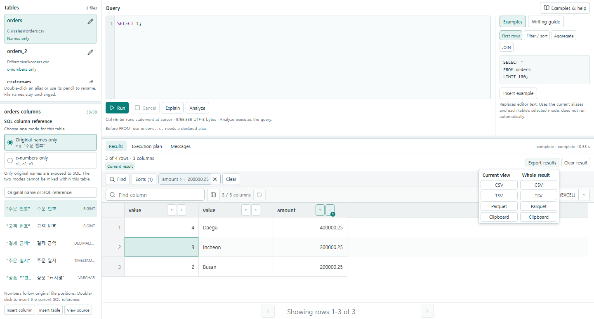

# Data Viewer

Data Viewer는 CSV와 Parquet 파일을 열어 볼 수 있는 Windows용 데스크톱 프로그램이다. 대용량 파일을 표 형태로 탐색하고, 필요한 셀이나 행을 선택해 Excel로 복사할 수 있다. 여러 파일을 SQL로 함께 조회하거나 쿼리 결과를 별도 파일로 저장할 수도 있다.

[**Windows용 Data Viewer 다운로드**](https://github.com/denrew88/parquet_viewer/releases/latest) · [**사용 설명서**](docs/USER_GUIDE.md) · [v0.23.0 변경 사항](#v0230에서-달라진-점)

## 시작하기

1. [GitHub Releases](https://github.com/denrew88/parquet_viewer/releases/latest)의 **Assets**에서 `data-viewer.exe`를 내려받아 실행한다.
2. **Open file**로 파일을 선택하거나 창에 끌어다 놓는다. 여러 파일을 열면 탭을 통해 전환할 수 있다.
3. **Data**에서 값을 보고, **Schema**에서 컬럼 타입을, **Metadata**에서 파일 정보를 확인한다.

열 제목에서 정렬과 필터를 적용하고 **Find**로 원하는 값을 찾을 수 있다. 셀 범위를 드래그하여 선택한 뒤 `Ctrl+C`를 누르면 Excel에 붙여넣을 수 있다. 행 번호나 열 제목을 클릭하면 행이나 열 전체를 선택한다.

## SQL로 조회하고 결과 저장하기

이 예제에서는 [샘플 orders.csv](fixtures/phase-22/sales/orders.csv)를 사용한다. GitHub 파일 화면에서 **Raw**를 선택하여 `orders.csv`로 저장한다.

1. 앱에서 `orders.csv`를 열고 오른쪽 위 **SQL** 탭으로 전환한다.
2. 왼쪽 **Tables**에 별칭이 `orders`로 표시되는지 확인하고, 아래 쿼리를 붙여 넣은 뒤 **Run**을 누른다.

   ```sql
   SELECT "주문 번호", "결제 금액"
   FROM orders
   ORDER BY "주문 번호"
   LIMIT 5;
   ```

3. **Results**에서 결과를 검색하거나 열 제목에서 정렬과 필터를 적용한다.
4. **Export results**에서 CSV, TSV, Parquet 또는 클립보드를 선택한다. 필터나 정렬을 적용한 경우 **Current view**는 화면에 적용된 범위와 순서를 반영하며, **Whole result**는 쿼리가 반환한 전체 결과를 내보낸다.

여러 CSV·Parquet 파일을 열면 **Tables**에 표시된 별칭으로 `JOIN`할 수 있다. **Explain**은 실행 계획을 표시하고, **Analyze**는 쿼리를 실행하여 연산별 시간을 표시한다. SQL 조회 조건은 파일 탭의 필터와 별도로 `WHERE` 절에 지정한다.



## 지원하는 파일

| 형식 | 열어서 할 수 있는 일 |
| --- | --- |
| **CSV** | UTF-8 파일의 표 보기와 SQL 조회를 지원한다. 읽기 설정에서 헤더와 컬럼 타입을 지정하고 적용 전에 미리 볼 수 있다. |
| **Parquet** | 컬럼 타입 확인, 메타데이터 보기, SQL 조회를 지원한다. Decimal과 타임스탬프의 정밀도를 보존한다. |
| **OEF H5 v3** | 해당 구조의 `.h5`, `.hdf5` 파일을 표로 표시한다. |

SQL 입력은 CSV와 Parquet를 지원한다. 원본 파일은 읽기 전용으로 열며, 기존 출력 파일은 Windows 저장 대화상자에서 덮어쓰기를 승인한 경우 교체한다. 열린 원본과 쿼리에 사용한 원본은 보호한다.

## v0.23.0에서 달라진 점

- SQL 결과에 정렬, 타입별 필터, Find를 추가했다. 쿼리 편집기와 결과 영역 사이의 높이도 조절할 수 있다.
- 현재 보기와 전체 결과를 따로 내보낼 수 있으며, 기존 출력 파일을 덮어쓸 수 있다.
- 대용량 SQL 결과를 저장하는 임시 파일 수를 줄여 결과 표시 시간을 단축했다.
- CSV와 SQL 결과의 시간 필터에서 나노초 단위의 경계를 정확히 비교한다.

[릴리스 검증 및 측정 기록](artifacts/phase-23/50-integration.md)
