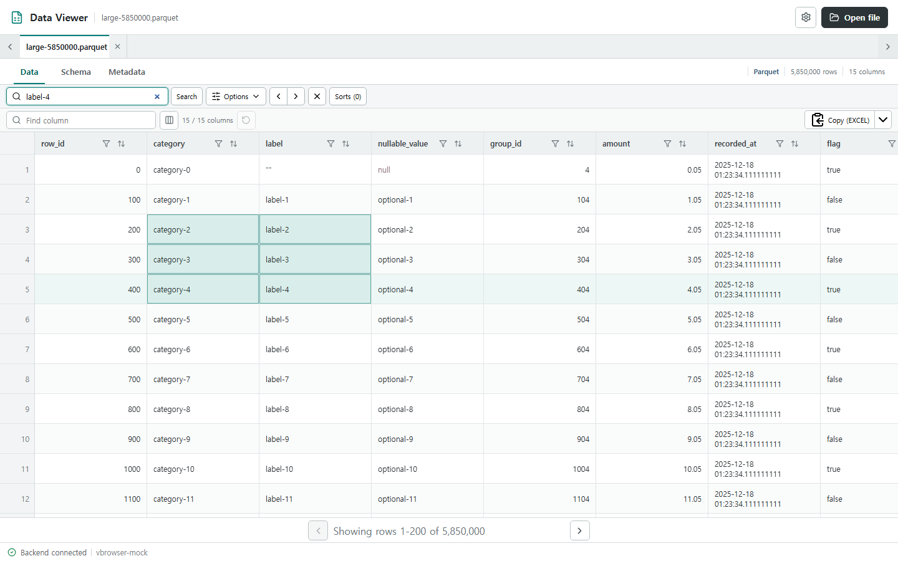
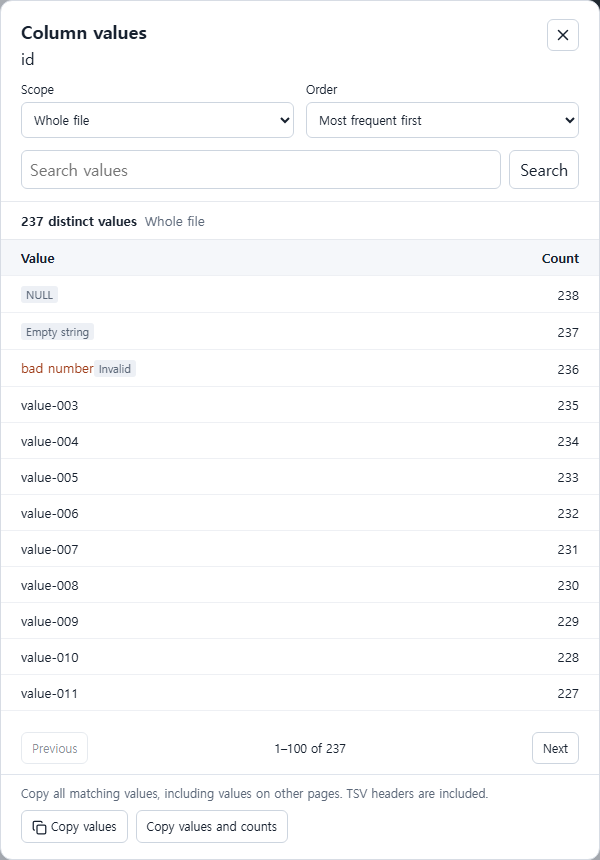
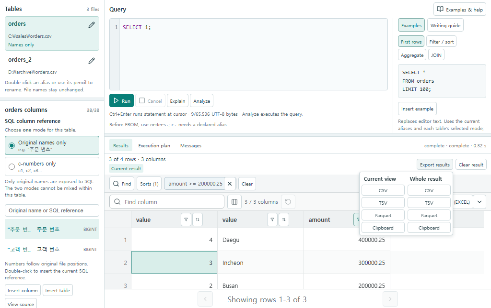
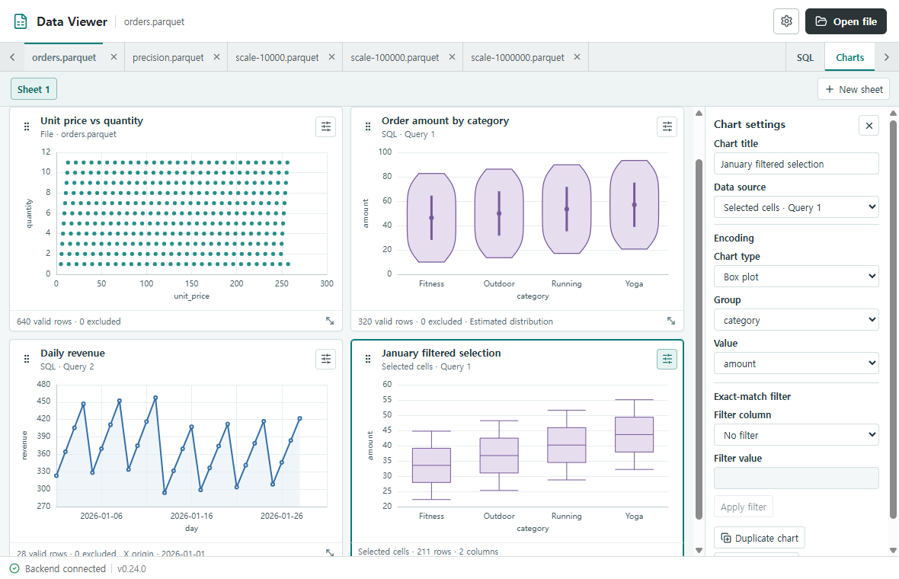
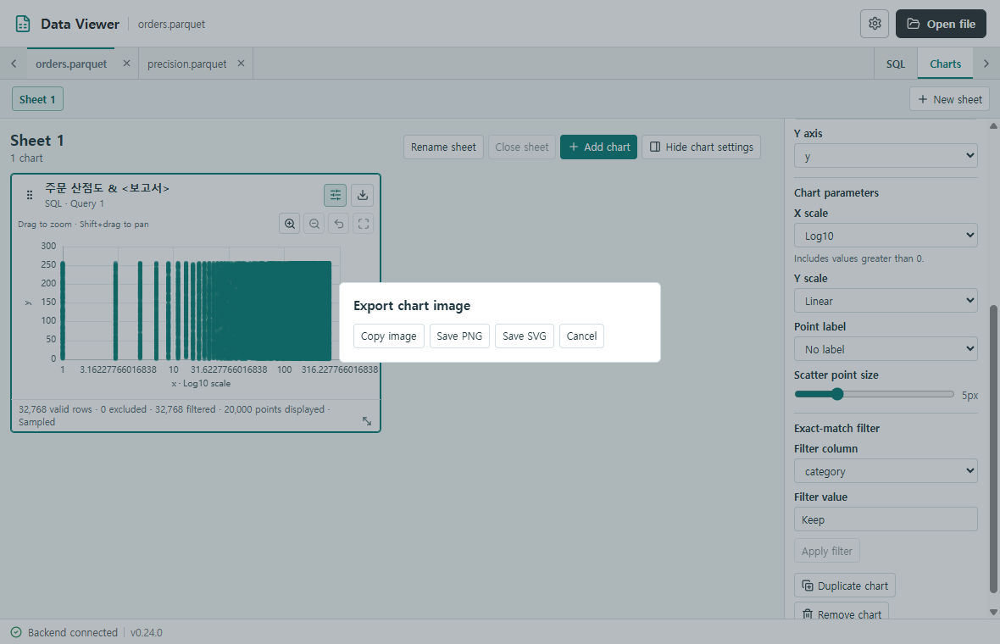
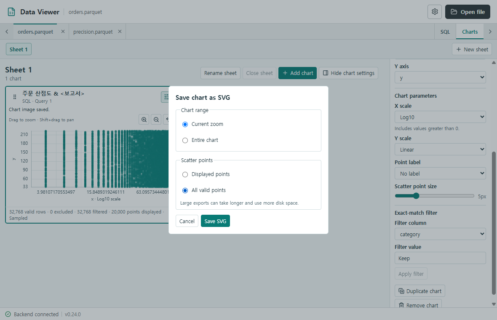
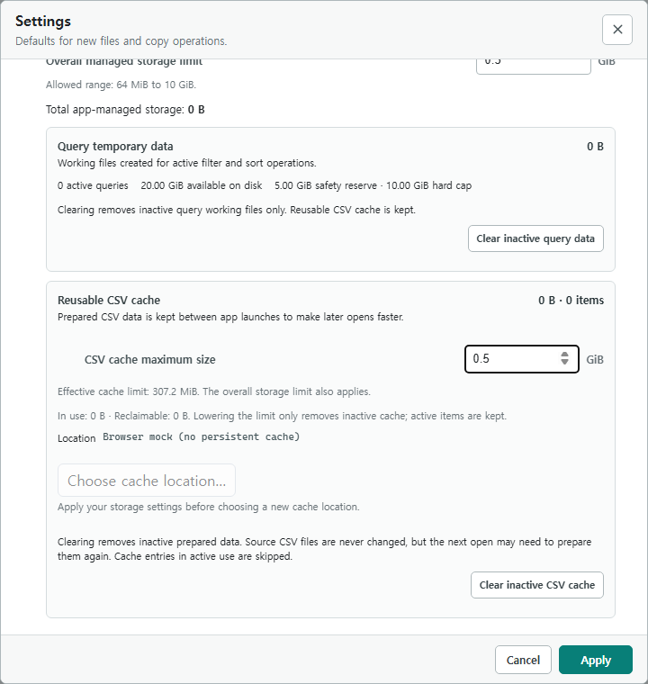

# Data Viewer 사용 설명서

Data Viewer는 Windows에서 CSV와 Parquet 파일을 표로 탐색하는 프로그램이다. 필요한 값을 찾아 Excel로 복사하거나, 여러 파일을 SQL로 조회하여 결과를 저장할 수 있다. 파일, SQL 결과 또는 선택한 셀 범위로 차트를 만들고 이미지로 복사하거나 저장할 수 있다.

- [다운로드와 파일 열기](#다운로드와-파일-열기)
- [CSV를 원하는 타입으로 읽기](#csv를-원하는-타입으로-읽기)
- [표에서 데이터 찾기](#표에서-데이터-찾기)
- [선택한 셀을 Excel에 붙여넣기](#선택한-셀을-excel에-붙여넣기)
- [SQL로 여러 파일 조회하기](#sql로-여러-파일-조회하기)
- [SQL 결과 저장하기](#sql-결과-저장하기)
- [여러 데이터 소스를 차트로 비교하기](#여러-데이터-소스를-차트로-비교하기)
- [차트 이미지 복사와 저장](#차트-이미지-복사와-저장)
- [문제 해결과 저장 공간 관리](#문제-해결과-저장-공간-관리)

## 다운로드와 파일 열기

1. Windows 10 또는 11에서 [GitHub Releases](https://github.com/denrew88/parquet_viewer/releases/latest)의 **Assets**에 있는 `data-viewer.exe`를 내려받아 실행한다.
2. 오른쪽 위 **Open file**에서 파일을 선택하거나 탐색기에서 앱 창으로 파일을 끌어 놓는다. 여러 파일을 한 번에 열면 각각 문서 탭에 표시된다.
3. **Data**에서 행과 열을 읽고, **Schema**에서 열 이름과 타입을 확인한다. 파일 형식과 관련된 정보는 **Metadata**에서 확인한다.

CSV는 UTF-8과 UTF-8 BOM을 지원한다. Parquet는 파일에 기록된 열 타입을 읽는다. `.h5`와 `.hdf5` 중에서는 OEF H5 v3 구조를 지원한다. 원본은 읽기 전용으로 열며, 같은 창에서 이미 열린 파일을 다시 열면 기존 탭이 활성화된다.

처음 열어 보는 큰 CSV는 표를 표시한 뒤 전체 행 수와 빠른 조회에 필요한 데이터를 백그라운드에서 준비할 수 있다. **Preparing CSV data**가 표시되는 동안에는 진행률을 확인할 수 있으며, 준비가 끝나면 페이지 이동과 쿼리 기능을 사용할 수 있다. 같은 파일과 읽기 설정에 해당하는 캐시가 있으면 다음 열기에서 재사용한다.

## CSV를 원하는 타입으로 읽기

CSV의 값은 원래 문자열로 기록된다. Data Viewer는 기본 **Auto** 모드에서 표본으로 타입을 판단한다. `00123` 같은 코드의 앞자리 0을 유지하려면 해당 열을 **Text**로 읽는다. 금액을 숫자 범위로 필터링하거나 합계에 사용하려면 **Decimal**, 주문 시각을 날짜 범위로 비교하려면 **Timestamp**가 적합하다.

1. CSV 탭에서 **CSV Parsing Profile**을 연다.
2. 열을 선택한 뒤 타입과 필요한 해석 옵션을 설정한다. 헤더 해석이 맞는지도 확인한다.
3. 미리보기의 **Raw**와 **Converted**를 오가며 원문과 변환 결과를 비교한다. 파일 전체의 변환 오류를 확인하려면 **Validate entire file**을 실행한다.
4. **Apply**로 설정을 적용한다. 변경한 프로필로 CSV 준비가 다시 시작될 수 있다.


위쪽 표에서 열의 **Type**을 선택하고, 아래쪽 **Raw**와 **Converted**에서 변환 전후의 값을 확인한다.

기본 열기 모드는 앱 설정에서 선택한다. **All Text**는 값에 기록된 문자열을 그대로 다루는 데 적합하고, **Ask Every Time**은 CSV를 열 때마다 프로필을 확인하는 데 적합하다. 변환에 실패한 값은 표에서 원문과 오류를 확인할 수 있다. SQL에서는 변환 실패 값이 `NULL`로 표시된다.

## 표에서 데이터 찾기

파일의 **Data** 탭과 **SQL Results**에는 검색, 필터, 정렬 도구가 있다. 필터는 행을 걸러내고, 정렬은 행 순서를 바꾸며, Find는 일치하는 셀로 이동한다.

| 하려는 일 | 조작 방법 |
| --- | --- |
| 특정 값이 있는 셀 찾기 | **Find** 또는 `Ctrl+F`로 검색을 열고 값을 입력한 뒤 **Search**를 누른다. 화살표 버튼으로 이전·다음 일치 항목으로 이동한다. **Options**에서 열, 대소문자, 정확히 일치할지 여부를 지정할 수 있다. |
| 조건에 맞는 행만 보기 | 열 머리글의 필터 버튼에서 **Operator**와 값을 지정한 뒤 **Apply**를 누른다. 여러 열의 필터를 적용하면 모든 조건을 만족하는 행이 표시된다. 활성 조건은 도구 모음에서 개별 제거할 수 있다. |
| 여러 열을 순서대로 정렬하기 | **Sorts**에서 **Add level**을 눌러 열과 방향을 지정한다. 위쪽 기준이 먼저 적용된다. 예를 들어 지역을 첫 기준, 금액 내림차순을 다음 기준으로 두면 같은 지역 안에서 금액이 큰 행이 먼저 나온다. |
| 한 열의 값과 빈도 확인하기 | 파일의 **Data**에서 열 머리글의 **Column values**를 연다. **Whole file**과 **Current filtered result** 중 범위를 고르고, 값을 검색하거나 빈도순으로 정렬한다. |
| 긴 셀의 값 전체 읽기 | 셀을 우클릭한 뒤 **View full value**를 선택한다. |

필터와 정렬은 현재 페이지를 넘어 전체 파일 또는 SQL 결과 전체에 적용된다. Find는 적용된 필터와 정렬을 기준으로 이동하며 표시 행 수를 바꾸지 않는다.



왼쪽 위에서 검색을 실행하고 화살표로 일치 항목 사이를 이동한다. 청록색으로 표시된 셀 범위는 오른쪽의 **Copy (EXCEL)**로 복사할 수 있다.

날짜와 시각을 범위로 검색하려면 **Timestamp** 열의 필터를 열고 범위 연산자를 고른다. 시각은 `2026-11-06 01:02`와 같이 24시간제로 입력한다. 초와 소수초는 `2026-11-06 01:02:03.123456789`처럼 입력할 수 있다. UTC 오프셋을 붙이는 경우 `2026-11-06 01:02:03+09:00`처럼 초를 포함한다.



**Column values**에서는 위쪽의 **Scope**로 범위를 바꾸고, 오른쪽 **Count**에서 값이 나온 횟수를 확인한다.

## 선택한 셀을 Excel에 붙여넣기

1. 셀 하나를 클릭하거나, 마우스로 드래그하여 직사각형 범위를 선택한다. 행 번호나 열 머리글의 선택 영역을 눌러 행 또는 열 전체를 선택할 수도 있다.
2. `Ctrl+C`를 누르거나 그리드의 **Copy** 버튼을 사용한다. 열 이름도 필요하면 우클릭 메뉴에서 **Copy with column headers**를 선택한다.
3. Excel에서 붙여넣을 첫 셀을 선택하고 `Ctrl+V`를 누른다.

기본 Excel 프리셋은 열을 탭으로, 행을 줄바꿈으로 구분한다. **Copy options**에서는 TSV, CSV 등 다른 프리셋을 선택할 수 있다. 필터가 적용된 표에서 `Ctrl+A`를 누르면 필터를 통과한 행과 표시 중인 열을 선택한다. 복사한 데이터에는 현재 정렬과 열 순서가 반영된다.

| 단축키 | 동작 |
| --- | --- |
| `Shift+클릭`, `Shift+방향키` | 선택 범위 확장 |
| `Ctrl+방향키` | 연속 데이터 또는 빈 셀 구간의 경계로 이동 |
| `Ctrl+Shift+방향키` | 해당 경계까지 선택 범위 확장 |
| `Ctrl+Alt+방향키` | 표 전체의 경계로 이동 |
| `Esc` | 확장 선택 해제 |

## SQL로 여러 파일 조회하기

1. [orders.csv](../fixtures/phase-22/sales/orders.csv)와 [customers.parquet](../fixtures/phase-22/customers.parquet)를 내려받아 연다. GitHub 파일 화면에서는 **Raw** 또는 다운로드 버튼을 이용한다.
2. 오른쪽 위 **SQL** 탭을 열고 **Tables**에서 두 파일의 별칭이 각각 `orders`, `customers`인지 확인한다.
3. 두 파일의 열 참조 방식을 **Original names only**로 두고 다음 쿼리를 **Run**으로 실행한다. 샘플 CSV의 헤더는 첫 행을 사용한다.

```sql
SELECT
  o."주문 번호",
  c."고객명",
  o."결제 금액"
FROM orders AS o
JOIN customers AS c ON o."고객 번호" = c."고객 번호"
ORDER BY o."주문 번호", c."고객명";
```

이 쿼리의 샘플 결과는 5행이다. 같은 고객 번호를 가진 고객 행이 둘이면 주문 한 건이 결과에 두 번 나타날 수 있다. 샘플에는 이러한 중복 키가 포함되어 있으므로 결과를 집계하기 전에 양쪽 파일에서 연결 키가 유일한지 확인한다.

열 이름에 공백이 있으면 큰따옴표로 감싼다. 헤더가 없거나 열 이름이 중복된 파일은 **c-numbers only**를 사용하여 `c1`, `c2`처럼 원본 열 위치를 참조한다. 파일 탭에 적용한 필터와 정렬은 SQL에 적용되지 않으므로 조회 조건은 `WHERE`, 순서는 `ORDER BY`에 지정한다.

**Tables**에서 별칭 위에 마우스를 올리거나 키보드로 초점을 두면 원본 파일 경로를 확인할 수 있다.

`WITH`로 정의한 CTE는 같은 문장의 `FROM`·`JOIN`에서 자동 완성할 수 있다. 다음 예에서
`FROM tot`를 입력하면 `totals`가 후보에 표시된다. `FROM totals AS t`를 작성한 뒤
`SELECT t.`의 점 뒤로 커서를 옮기고 `Ctrl+Space`를 누르면 `amount`가 표시된다.
후보는 `Tab` 또는 `Enter`로 적용한다.

```sql
WITH totals AS (
  SELECT SUM(o."결제 금액") AS amount
  FROM orders AS o
)
SELECT t.amount FROM totals AS t;
```

**Run**은 결과를 생성하고, **Explain**은 쿼리를 실행하지 않고 실행 계획을 보여 준다. **Analyze**는 쿼리를 실행해 실제 행 수와 연산별 시간을 보여 준다. 실행 중에는 **Cancel**로 중지할 수 있다. 필요한 열과 행만 확인하려면 `SELECT`에 열 이름을 명시하고 `LIMIT`으로 결과 행 수를 제한한다.

**New SQL tab**을 누르면 별도의 편집기와 결과가 있는 탭이 열린다. 각 탭에서 실행한 결과는
다른 탭으로 이동한 뒤에도 볼 수 있다. 다른 탭의 쿼리가 실행 중이면 새 요청은 순서대로 대기한다.
**Rename tab**을 누르거나 탭 이름을 더블클릭하면 이름을 바꿀 수 있다. 탭에 초점을 두고
`F2`를 눌러도 된다. `Enter`로 저장하고 `Esc`로 취소한다. 바꾼 이름은 **Charts**의
데이터 소스 목록에도 표시되며, 해당 탭에 연결한 차트는 기존 연결을 유지한다.

**Results**에서 셀을 선택하면 원본 **Data**와 같은 이동·선택 단축키를 사용할 수 있다.
`Shift+방향키`는 선택을 한 셀씩 확장하고, `Ctrl+방향키`는 데이터 영역 경계로 이동한다.
`Ctrl+Shift+방향키`는 같은 경계까지 선택을 확장한다. 필터나 정렬을 적용한 경우에는
화면에 반영된 결과의 행 순서를 기준으로 이동한다.

## SQL 결과 저장하기

1. **Results**에서 필요한 필터와 정렬을 적용한다.
2. **Export results**에서 내보낼 범위와 형식을 고른다.
3. 파일 형식은 저장 위치를 지정하고, **Clipboard**는 원하는 스프레드시트에 붙여넣는다.



**Export results** 메뉴에서 왼쪽은 현재 보기, 오른쪽은 전체 결과의 내보내기 형식이다.

| 범위 | 저장되는 행과 순서 |
| --- | --- |
| **Current view** | 결과 그리드에 적용한 필터를 통과한 모든 행을 현재 정렬 순서대로 저장한다. 여러 페이지에 걸친 행도 포함한다. |
| **Whole result** | 결과 그리드에 추가로 적용한 필터와 정렬 전의 전체 SQL 결과를 저장한다. SQL의 `WHERE`와 `ORDER BY`는 그대로 반영된다. |

현재 보기를 적용하지 않은 경우에는 형식만 선택한다. 그리드에서 일부 셀을 선택해도 내보내기 범위는 바뀌지 않는다. 선택한 셀만 옮기려면 그리드의 **Copy**를 사용한다.

CSV와 TSV 파일에는 열 이름이 포함된다. 파일 내보내기에서는 SQL `NULL`을 `\N`, 빈 문자열을 `""`로 기록한다. 열 타입을 유지하여 다른 데이터 도구로 넘기려면 **Parquet**를 선택한다. 기존 출력 파일을 선택하면 Windows 저장 대화상자에서 덮어쓰기를 확인한다. 거절하면 기존 파일이 유지되며, 열린 원본이나 해당 쿼리에 사용한 원본을 선택한 경우 저장이 차단된다.

## 여러 데이터 소스를 차트로 비교하기

1. **Charts → New sheet**에서 작업 공간을 만든다. 기존 Sheet에도 **Add chart**로 카드를 추가할 수 있다.
2. 오른쪽 설정에서 파일이나 SQL 탭을 소스로 선택하고 차트 종류와 축을 지정한다. 차트 종류를 선택하면 계산이 시작된다.
3. 카드를 추가하여 다른 소스와 나란히 배치한다. 카드 오른쪽 아래 손잡이를 드래그하여 폭과 높이를 조절한다. 손잡이에 초점을 두고 방향키로도 조절할 수 있다.

산점도는 두 수치 열의 관계를, 히스토그램은 한 수치 열의 분포를 보여 준다. 바이올린과 박스 플롯은
범주별 수치 분포를 비교한다. 선 그래프는 시간 또는 숫자에 따른 변화를 나타내며, 가로 막대는
범주별 행 수 또는 수치 합계를 비교한다. 카드에 표시되는 행 수와 표본 표시를 확인하면 차트에
어느 범위가 반영되었는지 알 수 있다.

카드를 선택한 뒤 오른쪽의 **Chart parameters**에서 차트 종류에 맞는 설정을 조정한다.

- **X scale** 또는 **Y scale**에서 수치 축의 척도를 선택한다. **Log (ln)**은 자연로그,
  **Log10**은 밑이 10인 로그, **Log1p**는 값에 1을 더한 뒤 계산한 자연로그이다.
  앞의 두 척도에는 양수만 포함되며, **Log1p**에는 0과 −1보다 큰 음수도 포함된다.
  선택한 척도의 범위를 벗어난 행 수는 카드에 표시된다.
- 히스토그램의 **Histogram bins**에서 **Auto**, **Number of bins**, **Bin width** 중 하나를
  선택한다. 수 또는 폭을 직접 입력한 뒤 **Apply histogram bins**를 누른다. 로그 척도에서
  폭은 로그 단위이다. 예를 들어 **Log10**에서 폭 1인 구간은 원래 값의 10배 범위에 해당한다.
- 바이올린의 **Violin bandwidth**는 밀도 곡선의 부드러움을 조정한다. 값을 입력하고
  **Apply bandwidth**를 누른다. 값이 클수록 곡선이 부드러워진다.

그래프 안에서 왼쪽 버튼으로 원하는 부분을 사각형으로 드래그한다. 마우스를 놓으면
사각형의 X·Y 범위가 확대된다. 확대된 상태에서 Shift를 누른 채 드래그하면 배율을
유지하면서 보이는 구간을 이동한다.
**Undo zoom**은 직전 범위로 돌아가고 **Reset zoom**은 전체 범위를 복원한다.
카드를 옮기려면 제목 옆 손잡이를 사용한다.

산점도에서 점 위에 포인터를 놓으면 원래 X·Y 값과 소스의 행 번호를 읽을 수 있다.
**Point label**로 품목 번호 등 식별 열을 추가할 수 있다. 카드 하단의 유효 행 수와
실제 표시 점 수를 확인한다. 선 그래프는 평균·합계와 시간 구간을 선택할 수 있으며,
표시된 점 사이의 간격을 지정해 긴 공백에서 선을 끊을 수 있다. 큰 데이터에서는 표시
한도에 맞춰 점을 줄이므로, 이 간격은 화면에 표시된 점을 기준으로 한다.

히스토그램은 건수·비율·밀도를 지원한다. 여러 파일을 비교할 때는 같은 최소·최대와
구간 설정을 적용한다. 고정 범위 밖의 행 수는 카드 하단에 별도로 표시된다.
막대 차트는 방향, 집계, 정렬, 표시할 범주 수, 값과 비율 레이블을 조정할 수 있다.

박스 플롯과 바이올린에 표시되는 점은 기본적으로 Q1·Q3에서 각각 1.5 IQR 바깥의 관측값이다.
포인터를 올리면 사분위수, 수염, 전체 이상치 수와 그려진 점 수를 확인할 수 있다.
박스 플롯은 최소·최대 수염으로 바꿀 수 있으며, 바이올린의 폭 기준은 카드 설정에서 선택한다.

SQL 결과의 **Send to chart**를 선택하면 해당 SQL 탭이 소스로 지정된다. 기본 설정에서는
그 탭의 다음 성공 결과를 차트에 반영한다. 두 실행을 비교하려면 한 카드를 복제하고 이전 결과에
고정한다. 결과의 열 이름이나 타입이 바뀌면 차트 설정에서 열을 다시 지정한다.



표에서 일부 행만 그리려면 파일 **Data** 또는 **SQL Results**에서 셀 범위를 선택하고,
우클릭 메뉴에서 **Create chart from selection**을 선택한다. 현재 필터와 정렬 상태의
선택 범위가 캡처되므로, 이후 표를 다시 정렬하거나 SQL을 재실행해도 이 카드에는 같은 블록이 표시된다.
Sheet, SQL 탭 및 선택 블록은 현재 앱 실행 세션에서 사용할 수 있다.
필터와 정렬을 적용하지 않은 파일에서 10만 셀을 넘는 열 전체를 선택하면 선택한 열을 파일에서
직접 읽어 그린다. 예를 들어 문자열 `category` 열을 선택하고 **Bar**를 고르면 범주별 건수를
확인할 수 있다. 이 차트를 다시 계산할 때는 연결된 파일 세션이 필요하다.

## 차트 이미지 복사와 저장

1. **Charts**에서 차트가 그려지면, 저장할 카드의 오른쪽 위에 있는 아래쪽 화살표 아이콘
   **Export chart image**를 누른다.
2. 용도에 맞는 형식을 선택한다.

   | 메뉴 | 동작 |
   | --- | --- |
   | **Copy image** | 현재 확대 상태를 이미지로 복사한다. 문서나 메신저에서 `Ctrl+V`로 붙여넣는다. |
   | **Save PNG** | 현재 확대 상태를 기본 2배 해상도의 PNG 파일로 저장한다. |
   | **Save SVG** | 축, 글자, 점을 확대해도 선명한 벡터 파일로 저장한다. 저장 전에 보기 범위를 선택한다. |

3. 파일로 저장할 때는 Windows 저장 대화상자에서 경로를 고른다. 기본 파일명은 차트 제목이다.
   기존 파일을 고르면 덮어쓰기를 확인한다.



이미지 한 장에는 선택한 카드의 제목과 그래프가 들어간다. 편집 버튼과 마우스 툴팁은 이미지에서 생략한다.

### 산점도를 SVG로 저장하기

**Save SVG**를 누르면 **Chart range**와 **Scatter points**를 각각 선택할 수 있다.

| 설정 | 선택지 | 저장되는 범위 |
| --- | --- | --- |
| **Chart range** | **Current zoom** | 화면에서 확대해 보고 있는 X·Y 범위 |
| **Chart range** | **Entire chart** | 확대하기 전의 전체 차트 범위 |
| **Scatter points** | **Displayed points** | 선택한 범위 안의 화면 표시 점. 큰 산점도에서는 최대 20,000점의 화면 표본을 사용한다. |
| **Scatter points** | **All valid points** | 선택한 범위 안에서 현재 필터를 통과하고 두 축에 그릴 수 있는 모든 점 |



카드 하단에 유효 행 32,768개와 표시 점 20,000개가 나온다면 **Entire chart**와
**All valid points**를 선택해 유효 점 32,768개를 저장할 수 있다. 일부 구간만 필요한 경우
그래프에서 먼저 확대한 뒤 **Current zoom**과 **All valid points**를 선택한다. 이 경우 화면
표본에 없던 점도 확대 영역 안에 있으면 저장된다.

전체 점을 저장할 때는 스캔한 행과 기록한 점의 수가 카드에 표시된다. **Cancel export**로
취소하면 기존 대상 파일이 유지된다. 전체 점 SVG는 최대 512 MiB까지 저장할 수 있다.

## 문제 해결과 저장 공간 관리

| 상황 | 확인할 항목 |
| --- | --- |
| CSV를 열 수 없거나 문자가 깨진다 | 원본 인코딩을 확인한다. UTF-16 등 다른 인코딩으로 저장된 파일은 UTF-8 사본을 만들어 연다. |
| 숫자나 날짜 필터가 나타나지 않는다 | **Schema**에서 해당 열이 텍스트로 해석되었는지 확인한다. CSV라면 **CSV Parsing Profile**에서 타입을 선택한 뒤 변환 결과를 확인한다. |
| 헤더가 첫 데이터 행으로 보인다 | CSV 읽기 설정에서 첫 행을 헤더로 사용할지 확인한다. |
| SQL에서 테이블 또는 열을 찾지 못한다 | **Tables**에서 현재 별칭과 열 참조 방식을 확인한다. 원본 이름 모드에서는 공백이 있는 열 이름을 큰따옴표로 감싼다. |
| SQL 실행이 임시 공간 한도에 걸린다 | 필요한 열과 행으로 쿼리를 줄이거나, 톱니바퀴 버튼으로 **Settings**를 열어 **Storage**의 전체 사용량과 **SQL temporary storage per query (GiB)**를 확인한다. 디스크 여유 공간도 함께 확인한다. |
| 저장이 실패하거나 덮어쓸 수 없다 | 다른 앱에서 출력 파일을 사용 중인지 확인한다. 저장 권한이 있는 폴더를 고르고 원본과 다른 파일 이름을 사용한다. |

**Settings → Storage**는 쿼리의 임시 데이터와 다시 사용할 수 있는 CSV 캐시를 구분하여 표시한다. 비활성 CSV 캐시는 **Clear inactive CSV cache**로 정리할 수 있다. 사용 중인 캐시와 원본 파일은 보호된다. 캐시를 정리한 CSV는 다음에 열 때 다시 준비할 수 있다.


